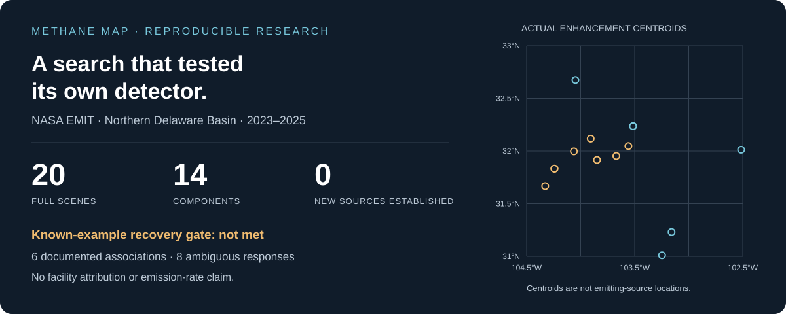
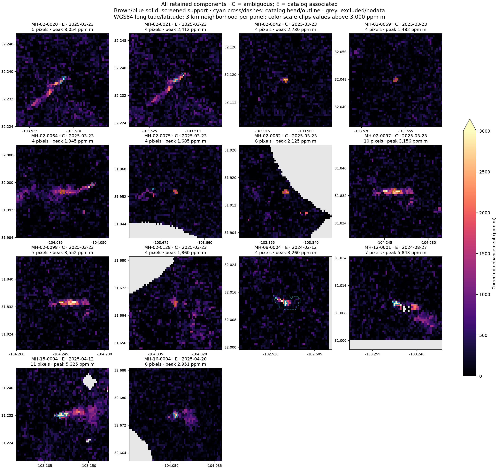

<div align="center">

# Methane Map

**An AI-assisted investigation into what public satellite observations can actually prove.**

[Read the investigation](reports/investigative_article.md) · [Explore the evidence](outputs/candidates.geojson) · [Reproduce the analysis](docs/REPRODUCIBILITY.md) · [Validation report](reports/validation_report.md)


</div>



## We went looking for overlooked methane. The detector became the finding.

Large methane releases can be visible from space. Public catalogs record many of
them, but a missing catalog entry can mean an overlooked plume, a weak signal,
an unpublished observation, or an artifact. **Methane Hunter**, the research
pipeline behind Methane Map, was built to investigate that uncertainty using
real observations and a complete audit trail.

The first investigation analyzed **20 full NASA EMIT scenes** in the northern
Delaware Basin, part of the Permian Basin in the United States. It produced
**14 screening components**. Six were associated with published observation
neighborhoods; eight remained ambiguous. **No new methane source was established.**

The decisive result came from validation: the conservative baseline associated
components with known observations in only **one of two positive scenes**.
That limits what its non-detections can tell us about missing emissions or
catalog completeness. The project records that failure alongside the results.

## The result at a glance

| Question | What the investigation found |
| --- | --- |
| What was examined? | 20 full granules across 16 dates, from 24 December 2023 to 22 September 2025 |
| Where? | Northern Delaware Basin; WGS84 `[-104.5, 31, -102.5, 33]` |
| How much usable data? | 15,917,415 usable pixel-observations, including repeated geography |
| Did known-example validation pass? | No. Baseline associations occurred in 1 of 2 positive scenes |
| What did the 16 search granules produce? | 4 components, all associated with published observations |
| What remained unresolved? | 8 ambiguous components in the second positive-validation scene |
| Was a new source confirmed? | No |
| Could the computation be repeated? | Exact local replay of 20 scene records and 14 component records; 56 recorded software tests passed |

**Components are connected groups of screened pixels. They are not counts of
independent plumes, emitting sources, or facilities.** A catalog association
using the same satellite observation is documentation, not independent physical
corroboration. No facility responsibility, emission rate, or annual emissions
were inferred.

## See the observations



These panels show actual sensitivity-corrected retrievals in **ppm m**. Blue
marks identify documented-observation associations (**E**); amber marks identify
ambiguous evidence (**C**). Gray pixels are excluded or unavailable. All panels
share a color scale that clips above 3,000 ppm m; each panel's title retains its
measured peak. Read the [individual visual assessments](reports/component_visual_review.md)
and [structured dossiers](outputs/dossiers/) before interpreting a bright feature.

The [GeoJSON register](outputs/candidates.geojson) can be explored directly on
GitHub. Its geometries describe enhancement support; they do not identify emitters.

## Read the story, then inspect the evidence

| Start here | What it contains |
| --- | --- |
| [Executive summary](reports/executive_summary.md) | The outcome, its significance, and the main limits |
| [Investigative article](reports/investigative_article.md) | The question, the access problem, the failed validation, and what survived scrutiny |
| [Validation report](reports/validation_report.md) | Positive examples, controls, threshold diagnostics, and unresolved alternatives |
| [Candidate register](outputs/candidates.csv) | All 14 component measurements and initial assessments |
| [Evidence dossiers](outputs/dossiers/) | Provenance, geometry, quality checks, catalog matches, and uncertainty for each component |
| [Experiment log](EXPERIMENT_LOG.md) | Five bounded experiments, including unsuccessful results |
| [Literature and methods](research/) | Primary scientific sources, hypotheses, and methodological decisions |

## How the pipeline works

1. **Freeze the sample.** Discover scenes through NASA CMR and retain exact IDs,
   selection roles, source requests, and catalog snapshots.
2. **Acquire the science data.** Download enhancement, sensitivity, sensor
   uncertainty, and matching official quality masks with hashes and a byte budget.
3. **Check alignment and quality.** Map cloud, cirrus, water, spacecraft, and
   dilated-cloud flags using the official geolocation lookup and exact grid checks.
4. **Screen conservatively.** Correct enhancement as `ENH / SENS`; retain at least
   four connected pixels above a 500 ppm m floor and local background/noise
   thresholds. The supplied uncertainty is already sensitivity-corrected.
5. **Challenge every component.** Compare spatial and temporal catalog context,
   inspect artifacts and fragmentation, and preserve unresolved alternatives.

The baseline is a transparent CPU screen, not a calibrated methane classifier.
The project reviewed MAPL-EMIT and existing retrieval methods; MAPL model
inference was not run. Details and primary references are in the
[methodology](research/methodology.md) and [literature review](research/literature_review.md).

## Run it locally

Python 3.12 is the reference version. The code, evidence, figures, and report
are included. Approximately **1.77 GB of raw scientific inputs are excluded
from Git** and can be reacquired through NASA Earthdata.

```sh
git clone https://github.com/MaxiBinz/methane-map.git
cd methane-map
python3 -m venv .venv
.venv/bin/python -m pip install -r requirements.lock.txt
.venv/bin/python -m pip install --no-deps -e .
.venv/bin/python -m pytest -q
```

Fetch the frozen scenes using the hidden token prompt, then analyze locally:

```sh
.venv/bin/methane-hunter fetch-nasa
.venv/bin/methane-hunter analyze
```

The downloader accepts `EARTHDATA_TOKEN` from a securely configured environment
or asks for it with terminal echo disabled. Never put credentials in commands,
notebooks, source files, or Git. See the complete
[reproduction guide](docs/REPRODUCIBILITY.md) for diagnostics, figures, hashes,
resource accounting, and reference versus replay receipts.

### Open the interactive report

```sh
python3 -m http.server 4173 --bind 127.0.0.1 --directory report_app/dist
```

Open [http://127.0.0.1:4173/?view=1](http://127.0.0.1:4173/?view=1) for the
interactive map, component selector, scientific figures, and inspectable sources.
Serve the entire `dist` directory so its data sidecar remains available.
GitHub publication does not deploy the report to GitHub Pages.

## Research integrity and scope

This is an AI-assisted, bounded convenience sample, not a census of the Permian
Basin. Two catalog-negative controls produced no baseline components, but their
catalog status does not prove methane absence. The failed positive gate keeps
strong discovery claims closed. Sensor uncertainty does not include all surface
clutter, and spectral, wind, and independent-sensor checks remain outstanding.

The next useful experiment is an independent spectral and surface-context review
of the eight ambiguous components, alongside a larger held-out validation set.
Lowering a threshold alone would not establish methane or novelty.

The original study is complete within its stated five-experiment scope.
[Project state](PROJECT_STATE.md), [findings](FINDINGS.md), and
[open questions](OPEN_QUESTIONS.md) preserve that boundary. Publication cleanup
does not change the frozen scientific measurements or classifications.

## Data attribution and reuse

NASA EMIT observations are credited to **NASA/JPL-Caltech and NASA LP DAAC**;
see [CH4ENH V002](https://doi.org/10.5067/EMIT/EMITL2BCH4ENH.002) and
[CH4PLM V002](https://doi.org/10.5067/EMIT/EMITL2BCH4PLM.002).
Catalog records are credited to **Carbon Mapper** and remain subject to its
[attribution and noncommercial terms](https://carbonmapper.org/terms).
Provider data are not relicensed by this repository.

No blanket open-source license has been selected for the repository's original
code and prose. Existing third-party notices and terms continue to apply. See
[data and rights notes](docs/DATA_AND_RIGHTS.md) and [citation metadata](CITATION.cff).
